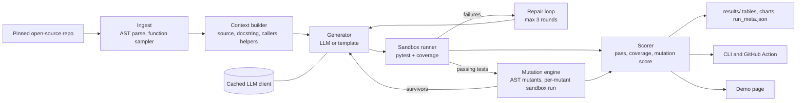

# PLAN.md: TestPilot

A tool that generates unit tests for real open-source Python projects with an LLM, repairs tests that fail, and grades the result by **mutation score** (how many injected bugs the tests catch), not just coverage. A study compares it with coverage-only generation.
Budget: 6 weeks of evenings and weekends, laptop plus phone only, free-tier APIs with cached calls, free hosting.

## Scope

| Area | Decision |
|---|---|
| Language | **Python first.** Java (PIT + JUnit) is dropped from the core and kept as a stretch goal (see Simplifications). Python 3.11. |
| Target repos | **12 small, pure-Python, permissively licensed open-source libraries** with no network or database needs, cloned at pinned commits. Candidates (final list and licences confirmed in Step 3): more-itertools, toolz, boltons, cachetools, python-slugify, humanize, tabulate, semver, sortedcontainers, idna, tomli, pyparsing (subset). Sizes span roughly 200 to 5,000 lines. The brief allows 10 to 20; 12 is the target. **Step 3 result:** packaging replaced pyparsing; the 12 repos span 620 to 20,400 source lines; licences verified from each LICENSE file. |
| Unit under test | **Functions and methods** chosen by a seeded sampler: up to 30 per repo, split 30% dev (tune prompts and repair) and 70% test (report). Candidates must be deterministic and runnable alone. **Step 3 result:** small libraries have few eligible functions, so the sample is **229 units (69 dev, 160 test)**, not 300; later budget figures scale by about 0.75. |
| Leakage control | The repo's own tests are moved out of the working copy before generation, so the LLM never sees them. They are used only as a **human-written reference** for coverage and mutation score. Memorisation of popular libraries is a stated limitation. |
| Main LLM | **Groq free API** (`TESTPILOT_GROQ_API_KEY`). Free-tier limits are about 200K tokens/day, so tokens are the binding constraint. Model ID and limits are verified in week 1 and recorded in `results/run_meta.json`. |
| Second LLM | **Gemini free API** (`TESTPILOT_GEMINI_API_KEY`) for a confirmation run on a subset. |
| Offline generator | A deterministic **template generator** (builds call-and-assert tests from type hints, defaults and docstring examples; no API). It lets the pipeline, CI and the full mutation grid run for free and gives a weak baseline. |
| Generation | Prompt = function source, signature, docstring, callers, imported helpers (function-level context, size-capped). Output = one pytest file. |
| Repair loop | Run the tests in the sandbox. On failure send back the error and ask for a fix, at most 3 rounds. Tests that still fail are dropped (and counted). A test that fails on the *unmodified* code is always a bad test, never a bug found. |
| Mutation testing | **Own small AST mutation engine** as the default (operator swaps such as `+`/`-`, `<`/`<=`, `and`/`or`, constant changes, return and negation changes, condition inversion; seeded sampling; per-mutant timeout). **mutmut** runs in Docker/CI as a cross-check on a subset. Reason: mutmut 3 does not run natively on Windows, and a small engine is easier to explain and test. Equivalent mutants cannot be removed automatically; this is a stated limitation, and mutants that survive the repo's own tests are flagged as likely equivalent. |
| Coverage | `coverage.py` with branch coverage. |
| Modes compared | M0 single-shot, no repair. M1 generate plus repair (pass/fail only). M2 **coverage-guided**: loop until coverage stops rising (CoverUp-style); this is the coverage-only comparison. M3 **mutation-guided**: feed surviving mutants back and ask for tests that kill them. Baselines: B0 offline template generator, B1 the repo's own human tests, B2 Pynguin (search-based, no LLM) on a subset if it installs cleanly on the laptop. |
| Scoring | Automatic only: pass rate on the original code, line and branch coverage, **mutation score** (killed / total mutants not flagged equivalent), the **coverage-vs-mutation gap**, flaky-test rate (3 reruns), LLM tokens per killed mutant. No LLM judge. |
| CLI | `testpilot ingest`, `generate`, `repair`, `mutate`, `report`, `compare`. Plain `argparse`. |
| GitHub Action | A composite action that runs `testpilot` on a repo's changed functions and posts the mutation score as a job summary. Tested on a small public sample repo with cached LLM responses. |
| Demo (Step 7) | Hosted page where a visitor picks an example function or pastes one, sees the generated tests, coverage and mutation score. Defaults to the template generator and cached LLM results; live calls are rate-limited and capped. Code runs only in the sandbox with strict limits. |
| Secrets | Only from `TESTPILOT_*` environment variables. Pre-commit gitleaks scan. `.env.example` has names with empty values. |
| Out of scope | LangChain/LlamaIndex, fine-tuning, non-Python targets in the core, real personal data, running code that is not open source, GPU use. |

## 1. Architecture



- **Ingest** (`testpilot/ingest/`): clones or loads a pinned repo, moves its tests to a reference folder, parses with `ast`, lists functions and methods, and samples units with a fixed seed.
- **Context builder** (`testpilot/context/`): for one unit, gathers source, signature, docstring, in-repo callers and the helpers it calls, trimmed to a token cap.
- **LLM client** (`testpilot/llm/`): one cached client (`client.py`, `cache.py`, `budget.py`, `groq.py`, `gemini.py`, `meta.py`). The cache key includes model, prompt, temperature and seed. The budget guard stops at 95% of the daily token limit, exits with code 75 and resumes after 00:00 UTC.
- **Generator** (`testpilot/generate/`): prompts, response parsing (extract one pytest file), the offline template generator, and the mode logic M0 to M3.
- **Sandbox** (`testpilot/sandbox/`): runs pytest or a mutant in a separate process with CPU-time and memory limits, empty environment, temporary working copy and no network (Docker in CI). The only place generated code ever runs.
- **Repair** (`testpilot/repair/`): the failure-feedback loop, with the "fails on original code means bad test" rule.
- **Mutation** (`testpilot/mutation/`): operators, mutant generation, runner, equivalence flagging, the mutmut cross-check wrapper.
- **Scoring and reports** (`testpilot/score/`, `testpilot/report/`): metrics, confidence intervals, tables and charts.
- **CLI and action** (`testpilot/cli.py`, `action/`).

**Metrics**
- Mutation score per mode and per repo, with 95% bootstrap confidence intervals over units.
- Line and branch coverage, and the gap between coverage and mutation score.
- Passing-test rate before and after repair; share of units where generation fails entirely.
- Cost: tokens and calls per unit, tokens per killed mutant.
- Variance: mean and spread over 3 seeds on a subset.

## 2. Call budget

Estimates, to be replaced by measurements in Step 4.

| Run | Units | Notes |
|---|---|---|
| Offline grid (free) | about 300 units, B0, B1, all mutation | No API calls. A small subset runs in CI. |
| LLM M0 and M1 | 210 test-split units | About 1 to 4 calls per unit at about 2,000 tokens, so roughly 1.2M tokens per mode, about 6 days of the 200K/day limit each. Run on the dev split first. |
| LLM M2 and M3 | 120-unit subset | Extra rounds; about 6 days each. Cut the unit count before cutting a mode. |
| Seeds and Gemini confirmation | 30-unit subset | Cut first if time runs short. |

Everything answered is cached, so reruns are free. Mutation runs use no LLM calls but cost CPU: the engine samples at most 40 mutants per unit and caps each mutant run at a few seconds.

## 3. Repo structure

```
testpilot/
├── testpilot/
│   ├── ingest/       # clone.py, parse.py, sampler.py
│   ├── context/      # builder.py
│   ├── llm/          # client.py, cache.py, budget.py, groq.py, gemini.py, meta.py
│   ├── generate/     # prompts.py, parse_response.py, template.py, modes.py
│   ├── sandbox/      # runner.py, limits.py
│   ├── repair/       # loop.py
│   ├── mutation/     # operators.py, mutate.py, runner.py, equivalence.py, mutmut_check.py
│   ├── score/        # metrics.py, stats.py
│   ├── report/       # tables.py, charts.py
│   ├── cli.py
│   └── config.py
├── action/           # GitHub Action (action.yml)
├── app/              # demo (Step 7)
├── data/             # repo manifest (URLs, commits, licences), saved splits
├── results/          # tables, charts, run_meta.json
├── docs/             # write-up
├── tests/
├── Dockerfile, docker-compose.yml, pyproject.toml, requirements*.txt
├── .pre-commit-config.yaml, .github/workflows/tests.yml
├── .env.example      # TESTPILOT_GROQ_API_KEY=  TESTPILOT_GEMINI_API_KEY=
└── README.md, PLAN.md, CLAUDE.md, BUILD_STEPS.md, LEARNING.md, PROGRESS.md
```

## 4. Week-by-week

| Week | Goal | Done when |
|---|---|---|
| 1 | Setup and plan checks (Steps 2-3) | Repo, CI, gitleaks, `.env.example`. Groq and Gemini models verified and recorded. Repo manifest with licences and pinned commits, sampler and saved splits, data report. |
| 2 | Ingestion and context (Step 4) | Parser, sampler, context builder, sandbox runner, with tests. Template generator produces runnable tests for most units. |
| 3 | Generation and repair (Step 5.1) | Cached LLM client, M0 and M1, repair loop. Dev-split run started. |
| 4 | Mutation and scoring (Step 5.2-5.3) | Mutation engine with tests, mutmut cross-check, coverage-guided M2 and mutation-guided M3, scorer. |
| 5 | CLI, Action, evaluation (Steps 5.4, 6) | CLI, GitHub Action, resumable test-split runs, seeds, charts, limitations. |
| 6 | Demo and ship (Steps 7-8) | Demo deployed, README, write-up, portfolio card. No new features. |

## 5. Risks and first checks

1. **Mutation testing cost and tooling.** Each mutant needs a test run, so 300 units x 40 mutants x several modes is a lot of CPU on a laptop, and mutmut does not run natively on Windows. *Check first:* time one unit end to end with the own engine; cap mutants per unit and per-run time; run mutmut only in Docker on a subset.
2. **Free-tier limits and LLM memorisation.** Token caps are tight, and popular libraries may be memorised, which inflates scores. *Check first:* current Groq model list and limits and a 20-call smoke test; measure how often the output reproduces the removed repo tests. Prefer smaller, less famous libraries and report the limitation.
3. **Safety and licences.** Generated tests execute code. *Check first:* every repo's licence (permissive only) and that the sandbox blocks network and file writes outside its temp directory before any LLM output is run. Equivalent mutants and flaky tests can distort scores: flag equivalents, rerun passing tests 3 times.

## 6. Simplifications

- Python only in the core; Java/PIT is a stretch goal after Step 8, if time and a JDK are available.
- Own small mutation engine as default, with mutmut as a cross-check, instead of mutmut only.
- Plain `argparse` CLI, no framework.
- Template generator so most experiments cost nothing.
- Cached LLM calls and a demo that defaults to cached results.

## Concepts (plain language + one reading each)

- **Mutation testing and mutation score.** Reading: Papadakis et al., "Mutation Testing Advances: An Analysis and Survey" (2019).
- **Coverage versus test strength.** Reading: Inozemtseva and Holmes, "Coverage Is Not Strongly Correlated with Test Suite Effectiveness" (2014).
- **LLM test generation with feedback.** Reading: CoverUp (Altmayer Pizzorno and Berger, 2024) and ChatUniTest (Chen et al., 2023).
- **Search-based test generation.** Reading: Pynguin (Lukasczyk and Fraser, 2022).
- **Sandboxing untrusted code.** Reading: the Python `subprocess` and `resource` docs.
