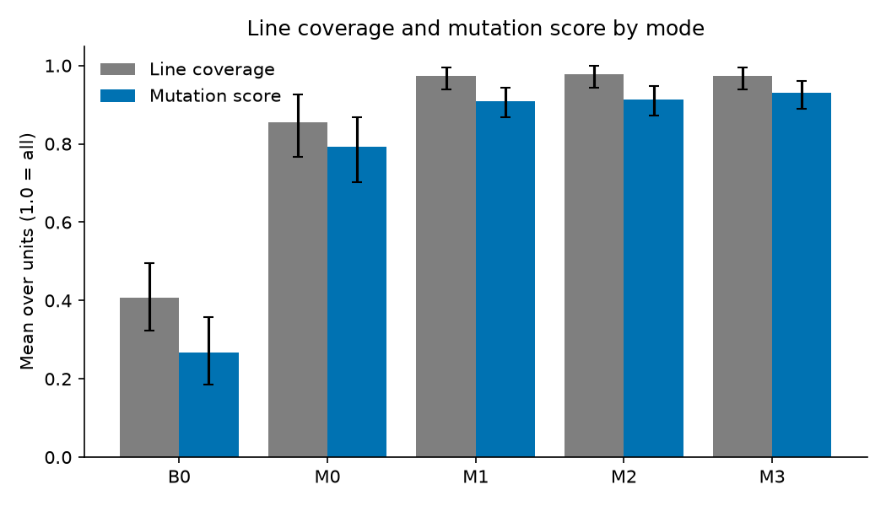
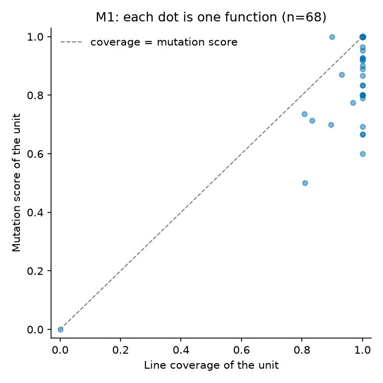
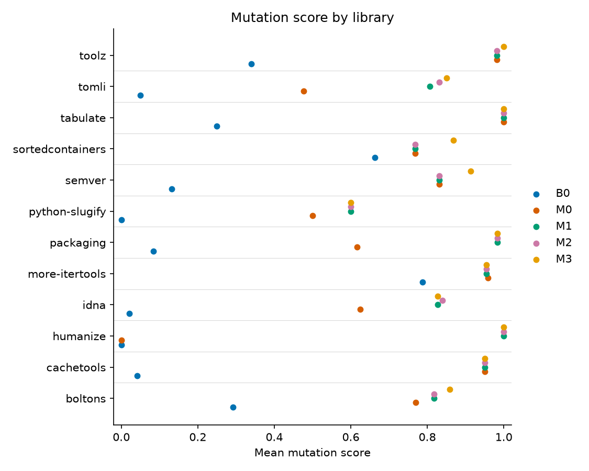

# Evaluation (dev split)

Scoring is fully automatic (tests run in the sandbox; no LLM judge). Primary metric: **mutation
score**, the share of injected bugs the tests catch. Line and branch coverage are reported beside
it, because the project's question is how far coverage overstates test quality.

Modes with scored units here: B0 offline template (baseline), M0 single LLM call, M1 + repair, M2 coverage-guided (the coverage-only comparison), M3 mutation-guided.
Modes without data are left out, not estimated.

**Units compared: 68**, the ones scored in every listed mode (scored so far per mode:
B0 68, M0 68, M1 68, M2 68, M3 68). Modes are compared on identical
units so an easier set of units cannot flatter one of them.

## Results

Values are means with 95% bootstrap intervals over units.

| Mode | Units | With tests | Line cov | Branch cov | Mutation score | Cov - mutation gap | Tokens/unit | Tokens/killed mutant |
|---|---|---|---|---|---|---|---|---|
| B0 | 68 | 65 | 0.41 [0.32, 0.49] | 0.30 [0.20, 0.39] | 0.27 [0.19, 0.36] | +0.14 | 0 | 0 |
| M0 | 68 | 60 | 0.85 [0.77, 0.93] | 0.94 [0.89, 0.98] | 0.79 [0.70, 0.87] | +0.06 | 1516 | 188 |
| M1 | 68 | 67 | 0.97 [0.94, 0.99] | 0.98 [0.96, 0.99] | 0.91 [0.87, 0.94] | +0.06 | 3092 | 296 |
| M2 | 68 | 67 | 0.98 [0.94, 1.00] | 0.98 [0.97, 0.99] | 0.91 [0.87, 0.95] | +0.07 | 3523 | 335 |
| M3 | 68 | 67 | 0.97 [0.94, 0.99] | 0.98 [0.96, 0.99] | 0.93 [0.89, 0.96] | +0.04 | 4822 | 455 |

M3 minus M2 on the same units (positive = mutation-guided is better): mutation score 0.02 [0.00, 0.03] (n=68), line coverage -0.00 [-0.01, 0.00] (n=68).

**Do not read M3's mutation score as a fair win.** M3 is shown the mutants that survived, keeps a
new test file only if its score on them rises, and is then scored on those same mutants. Its score
therefore cannot fall below that of the M1 tests it started from, and any lead over M1 or M2 is
biased in its favour, whatever the interval says. M3 also asked for more guided rounds where its
signal had more left to improve, so compare its tokens per unit too.







## By library (mean mutation score)

| Library | B0 | M0 | M1 | M2 | M3 |
|---|---|---|---|---|---|
| boltons | 0.29 (n=9) | 0.77 (n=9) | 0.82 (n=9) | 0.82 (n=9) | 0.86 (n=9) |
| cachetools | 0.04 (n=4) | 0.95 (n=4) | 0.95 (n=4) | 0.95 (n=4) | 0.95 (n=4) |
| humanize | 0.00 (n=1) | 0.00 (n=1) | 1.00 (n=1) | 1.00 (n=1) | 1.00 (n=1) |
| idna | 0.02 (n=4) | 0.62 (n=4) | 0.83 (n=4) | 0.84 (n=4) | 0.83 (n=4) |
| more-itertools | 0.79 (n=9) | 0.96 (n=8) | 0.95 (n=9) | 0.95 (n=9) | 0.95 (n=9) |
| packaging | 0.08 (n=9) | 0.62 (n=8) | 0.98 (n=9) | 0.98 (n=9) | 0.98 (n=9) |
| python-slugify | 0.00 (n=1) | 0.50 (n=1) | 0.60 (n=1) | 0.60 (n=1) | 0.60 (n=1) |
| semver | 0.13 (n=4) | 0.83 (n=4) | 0.83 (n=4) | 0.83 (n=4) | 0.91 (n=4) |
| sortedcontainers | 0.66 (n=2) | 0.77 (n=2) | 0.77 (n=2) | 0.77 (n=2) | 0.87 (n=2) |
| tabulate | 0.25 (n=9) | 1.00 (n=9) | 1.00 (n=9) | 1.00 (n=9) | 1.00 (n=9) |
| tomli | 0.05 (n=7) | 0.48 (n=7) | 0.81 (n=7) | 0.83 (n=7) | 0.85 (n=7) |
| toolz | 0.34 (n=9) | 0.98 (n=9) | 0.98 (n=9) | 0.98 (n=9) | 1.00 (n=9) |

## Variance over seeds

Not run yet: no mode has more than one seed scored. LLM modes need an API key; see the run commands below.

## Counts

- B0: 68 units scored, 3 with no passing test, 779 mutants of which 0 flagged likely-equivalent.
- M0: 68 units scored, 8 with no passing test, 630 mutants of which 0 flagged likely-equivalent.
- M1: 68 units scored, 1 with no passing test, 798 mutants of which 0 flagged likely-equivalent.
- M2: 68 units scored, 1 with no passing test, 798 mutants of which 0 flagged likely-equivalent.
- M3: 68 units scored, 1 with no passing test, 798 mutants of which 0 flagged likely-equivalent.

## How to reproduce

```
python -m testpilot.evaluate --modes b0 m1 m2 m3 --split dev --seeds 0
python -m testpilot.cli report --split dev --seeds 0
```

See limitations.md for what these numbers do not show.
