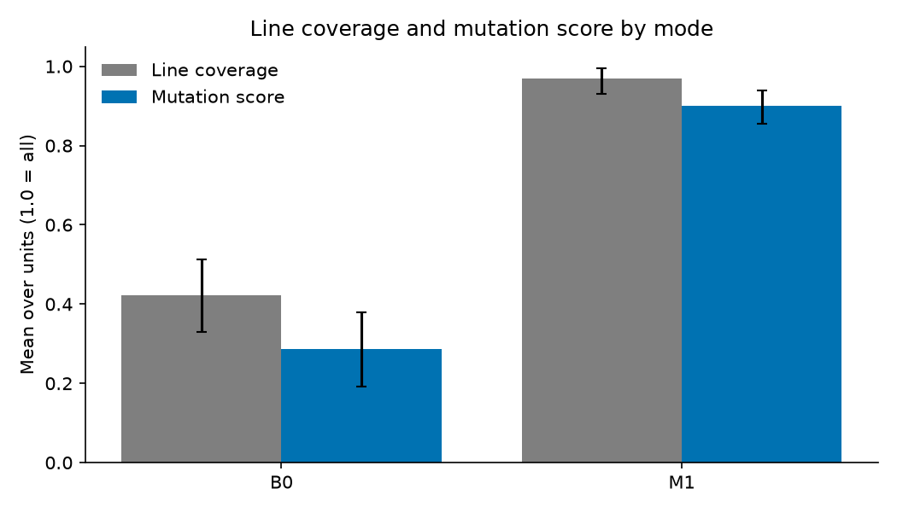
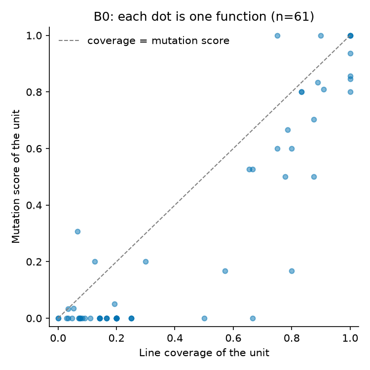
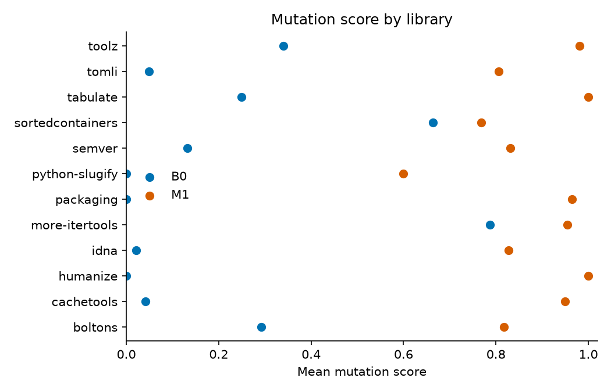

# Evaluation (dev split)

Scoring is fully automatic (tests run in the sandbox; no LLM judge). Primary metric: **mutation
score**, the share of injected bugs the tests catch. Line and branch coverage are reported beside
it, because the project's question is how far coverage overstates test quality.

Modes with scored units here: B0 offline template (baseline), M1 + repair.
Modes without data are left out, not estimated.

**Units compared: 61**, the ones scored in every listed mode (scored so far per mode:
B0 68, M1 61). Modes are compared on identical
units so an easier set of units cannot flatter one of them.

## Results

Values are means with 95% bootstrap intervals over units.

| Mode | Units | With tests | Line cov | Branch cov | Mutation score | Cov - mutation gap | Tokens/unit | Tokens/killed mutant |
|---|---|---|---|---|---|---|---|---|
| B0 | 61 | 59 | 0.42 [0.33, 0.51] | 0.31 [0.21, 0.41] | 0.29 [0.19, 0.38] | +0.14 | 0 | 0 |
| M1 | 61 | 60 | 0.97 [0.93, 0.99] | 0.98 [0.96, 0.99] | 0.90 [0.86, 0.94] | +0.07 | 3025 | 304 |







## By library (mean mutation score)

| Library | B0 | M1 |
|---|---|---|
| boltons | 0.29 (n=9) | 0.82 (n=9) |
| cachetools | 0.04 (n=4) | 0.95 (n=4) |
| humanize | 0.00 (n=1) | 1.00 (n=1) |
| idna | 0.02 (n=4) | 0.83 (n=4) |
| more-itertools | 0.79 (n=9) | 0.95 (n=9) |
| packaging | 0.00 (n=2) | 0.96 (n=2) |
| python-slugify | 0.00 (n=1) | 0.60 (n=1) |
| semver | 0.13 (n=4) | 0.83 (n=4) |
| sortedcontainers | 0.66 (n=2) | 0.77 (n=2) |
| tabulate | 0.25 (n=9) | 1.00 (n=9) |
| tomli | 0.05 (n=7) | 0.81 (n=7) |
| toolz | 0.34 (n=9) | 0.98 (n=9) |

## Variance over seeds

Not run yet: no mode has more than one seed scored. LLM modes need an API key; see the run commands below.

## Counts

- B0: 61 units scored, 2 with no passing test, 680 mutants of which 0 flagged likely-equivalent.
- M1: 61 units scored, 1 with no passing test, 692 mutants of which 0 flagged likely-equivalent.

## How to reproduce

```
python -m testpilot.evaluate --modes b0 m1 m2 m3 --split dev --seeds 0 1 2
python -m testpilot.cli report
```

See limitations.md for what these numbers do not show.
